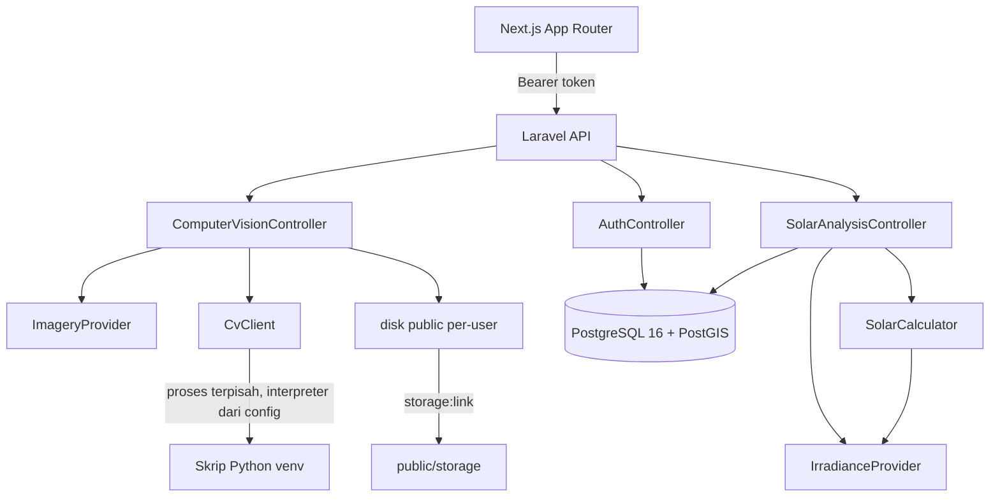

# Sunsight MVP Vertical Slice - Plan

## Goal Capsule

- **Objective:** Satu alur analisis surya berjalan dari ujung ke ujung — user login, menggambar area atap pada citra, menjalankan pipeline CV, menerima estimasi energi harian, dan melihatnya tersimpan di riwayat.
- **Authority hierarchy:** `API CONTRACT.md` (setelah U1 membekukannya) otoritatif untuk bentuk wire format. Plan ini otoritatif untuk urutan dan batas unit. `README.md` otoritatif untuk tech stack.
- **Execution profile:** `code`. PHP 8.3 + Laravel 13 + PostgreSQL 16/PostGIS di lokal; Next.js 16 App Router di lokal. Tanpa Docker.
- **Stop conditions:** Hentikan dan eskalasi bila (a) ekstensi PostGIS tidak dapat dipasang pada basis data aplikasi maupun basis data test dan tidak ada jalan mundur yang disetujui, (b) tidak ada satu pun sumber citra yang dapat dipakai dan fixture lokal belum tersedia, atau (c) virtual environment Python tidak dapat dibangun sehingga `ProcessCvClient` tidak punya interpreter. Selain itu, lanjutkan dengan asumsi yang tercatat.
- **Definition of "kelihatan" (target besok):** bukti berupa tangkapan layar browser yang memperlihatkan halaman analisis berisi citra, poligon yang digambar user, angka kWh, dan entri riwayat hasil penyimpanan.

## Product Contract

### Summary

Sunsight menaksir efektivitas pemasangan panel surya di atap bangunan dengan menggabungkan citra nadir (satelit/udara), deteksi batas atap, pembuangan area berbayang, dan kalkulasi energi berbasis iradiasi lokasi. Backend menyediakan REST API ber-Sanctum; frontend menyediakan ruang kerja peta dan riwayat analisis.

Saat ini seluruh controller backend masih berisi `TODO` kosong dan frontend masih boilerplate `create-next-app`. Plan ini membangun slice vertikal tipis lebih dulu: satu alur penuh yang benar, bukan banyak fitur setengah jadi.

### Problem Frame

Belum ada satu pun endpoint yang berfungsi, sehingga FE dan BE belum punya titik temu yang bisa dites. Tanpa membekukan kontrak lebih dulu, dua sisi akan menebak bentuk payload dan koordinat secara berbeda, dan integrasi gagal di akhir. Prioritas karena itu adalah membekukan antarmuka, menyalakan environment, lalu mengisi alur utama dari belakang ke depan.

### Requirements

**Autentikasi dan pengguna**

- R1. Sistem menerima pendaftaran dengan `name`, `email`, `password`, `password_confirmation` dan mengembalikan Sanctum token.
- R2. Sistem menerima login dengan `email`, `password` dan mengembalikan Sanctum token.
- R3. Sistem mencabut token aktif pada logout.
- R4. Sistem mengembalikan profil user aktif dari endpoint terproteksi.

**Pipeline citra**

- R5. Sistem mengunduh citra nadir untuk koordinat dan zoom yang diminta, menyimpannya, dan mengembalikan identitas aset yang tidak bisa ditebak beserta bbox citra dan URL yang dapat dimuat browser.
- R6. Sistem merapikan poligon kasar milik user menjadi poligon presisi batas atap.
- R7. Sistem menaksir area atap yang tidak berbayang dari poligon presisi dan mengembalikan luas area terpakai, luas area berbayang, dan mask bayangan.
- R8. Setiap aset citra hanya dapat diproses oleh user pemiliknya.

**Kalkulasi energi**

- R9. Sistem menerima luas area terpakai, titik tengah, dan poligon, lalu mengembalikan estimasi energi harian, iradiasi lokasi, dan orientasi atap.
- R10. Setiap hasil kalkulasi menyimpan asumsi yang dipakai (efisiensi modul, performance ratio, faktor kemiringan, nilai iradiasi, sumber dan periode iradiasi), mengembalikannya bersama hasil kalkulasi, dan menyimpannya saat analisis disimpan.

**Riwayat analisis**

- R11. Sistem mengembalikan daftar riwayat milik user aktif dengan paginasi.
- R12. Sistem menyimpan satu hasil kalkulasi lengkap beserta poligon dan asumsinya.
- R13. Sistem mengembalikan detail satu riwayat milik user aktif, termasuk asumsi yang dipakai.
- R14. Sistem menghapus satu riwayat milik user aktif.

**Antarmuka pengguna**

- R15. User dapat mendaftar dan login, dan token disimpan sehingga permintaan berikutnya terautentikasi.
- R16. User dapat melihat citra, menggambar poligon atap di atasnya, menjalankan pipeline, dan melihat hasil kalkulasi.
- R17. User dapat melihat daftar riwayat, membuka detail, dan menghapus satu entri.
- R18. Antarmuka menampilkan pesan kesalahan yang bermakna untuk kegagalan autentikasi dan validasi.

**Kontrak antarmuka**

- R19. Bentuk payload, satuan, ruang koordinat, dan amplop kesalahan terdokumentasi dalam satu berkas kontrak yang dipakai bersama FE dan BE, dan berkas itu tidak memuat endpoint di luar lingkup yang dikerjakan.

### Flows

- F1. Alur utama analisis atap
  - **Trigger:** User terautentikasi membuka halaman analisis dan mengirim koordinat lokasi.
  - **Steps:** FE memanggil akuisisi citra; user menggambar poligon kasar pada citra; FE mengirim poligon kasar untuk dirapikan; FE mengirim poligon presisi untuk analisis bayangan; FE mengirim luas area terpakai dan poligon ke kalkulasi; user menyimpan hasil.
  - **Outcome:** Satu baris riwayat berisi poligon, luas, asumsi, dan estimasi energi.
  - **Covered by:** R5, R6, R7, R9, R12, R16
- F2. Alur riwayat
  - **Trigger:** User membuka halaman riwayat.
  - **Steps:** FE memuat daftar berhalaman; user memilih satu entri; FE memuat detail; user menghapus entri.
  - **Outcome:** Daftar menyusut dan entri hilang dari database.
  - **Covered by:** R11, R13, R14, R17

### Acceptance Examples

- AE1. Akun baru lalu akses terproteksi
  - **Covers:** R1, R4, R15
  - **Given:** Tidak ada user dengan email tersebut.
  - **When:** FE mengirim pendaftaran valid, lalu memakai token hasilnya untuk meminta profil.
  - **Then:** Pendaftaran mengembalikan token, dan permintaan profil mengembalikan `id`, `name`, `email`.
- AE2. Aset citra milik user lain
  - **Covers:** R8
  - **Given:** User A memiliki aset citra, user B terautentikasi.
  - **When:** User B mengirim identitas aset milik A ke tahap perapian poligon.
  - **Then:** Sistem menolak tanpa membocorkan keberadaan aset tersebut.
- AE3. Asumsi ikut tersimpan dan ikut kembali
  - **Covers:** R10, R12, R13
  - **Given:** Sebuah analisis berhasil dihitung lalu disimpan.
  - **When:** Detail analisis dibuka kembali.
  - **Then:** Respons memuat nilai efisiensi, performance ratio, faktor kemiringan, iradiasi, sumber, dan periode yang dipakai saat kalkulasi, bukan hanya angka energi akhirnya.
- AE4. Validasi gagal
  - **Covers:** R18
  - **Given:** FE mengirim login dengan email tidak valid.
  - **When:** Respons 422 diterima.
  - **Then:** Antarmuka menampilkan pesan per-field, bukan kegagalan generik.

### Scope Boundaries

**Ditunda, bukan bagian dari slice ini**

- Reset dan lupa password. Membutuhkan infrastruktur email dan tidak masuk alur yang didemokan. Route dan metodenya dihapus dari kode dan dari kontrak, bukan dibiarkan sebagai stub.
- Ekspor PDF riwayat analisis.
- Peta interaktif penuh dengan ubin yang bisa digeser. Slice ini memakai citra statis satu bidikan.
- Ortorektifikasi, DSM, atau data ketinggian bangunan.
- Multi-tenant, peran, dan berbagi analisis antar-user.

**Di luar identitas produk**

- Perhitungan finansial, tarif listrik, dan payback period.
- Perencanaan tata letak modul, stringing inverter, dan desain kelistrikan.
- Deteksi otomatis lokasi atap dari alamat tanpa interaksi user.

### Open Questions

- OQ1 (deferred). Sumber citra dan lisensinya. Kandidat: citra udara milik sendiri, penyedia ubin komersial, atau citra satelit resolusi menengah. Tidak memblokir karena U5 diabstraksi di balik satu antarmuka dan fixture citra menjadi jalur mundurnya; keputusan ini mengubah kualitas hasil, bukan bentuk kode.
- OQ2 (deferred). Runner test frontend. Repo ini belum memasang satu pun, sehingga verifikasi FE bersandar pada pemeriksaan tipe, lint, dan smoke di browser.
- OQ3 (deferred). Apakah orientasi atap perlu diturunkan dari data ketinggian. Dari citra nadir murni, arah kemiringan tidak dapat diketahui; lihat KTD-7.

## Planning Contract

### Key Technical Decisions

- KTD-1. **PostgreSQL 16 dengan ekstensi PostGIS sebagai satu-satunya basis data.** PostgreSQL 16.11 sudah terpasang di mesin ini; yang belum ada hanya paket ekstensi PostGIS dan service yang mati. Satu konvensi penyimpanan geometri lebih baik daripada JSON sekarang lalu bermigrasi nanti, dan `README.md` menjanjikan PostGIS. *Jalan mundur:* bila paket ekstensi tidak dapat dipasang, simpan poligon sebagai GeoJSON di kolom `json` dan catat deviasinya di `README.md`.
- KTD-2. **Jembatan PHP ke Python lewat pemanggilan proses.** `CvClient` menjadi antarmuka di PHP; implementasi nyatanya memanggil skrip Python sebagai proses terpisah dan bertukar berkas di penyimpanan lokal. Ini satu unit deploy, tidak butuh service tambahan, dan sesuai skala proyek kuliah.
- KTD-3. **Dua ruang koordinat, dan batasnya dipatok eksplisit.** `refine-polygon` dan `detect-shadow` bekerja pada koordinat piksel relatif citra; `solar/calculate` dan poligon tersimpan bekerja pada GeoJSON `[lng, lat]`. Konversi piksel ke lat/lng dilakukan memakai bbox Web Mercator yang dikembalikan endpoint akuisisi citra, dan FE memakai bbox yang sama untuk menggambar.
- KTD-4. **Aset citra memakai identitas opaque, bukan nama berkas yang dapat ditebak.** Akuisisi citra mengembalikan `image_id` berupa UUID, berkas disimpan di bawah direktori per-user, dan tahap pemrosesan memvalidasi kepemilikan sebelum membaca. Ini menutup akses lintas-user terhadap aset orang lain.
- KTD-5. **Amplop kesalahan mengikuti default Laravel, dan login gagal dipatok ke 401.** `422` berbentuk `{"message", "errors": {field: [...]}}`; `401` berbentuk `{"message": "Unauthenticated."}` dengan pesan yang sama untuk email tidak terdaftar maupun password salah. FE menangani dua bentuk ini saja.
- KTD-6. **Satuan hasil diberi nama yang benar dan berbasis hari.** Energi harian dalam `estimated_energy_kwh_per_day`; nama lama `estimated_power_kwh` mencampur satuan daya dengan energi. Iradiasi dalam kWh/m²/hari dari klimatologi NASA POWER.
- KTD-7. **Azimut yang dilaporkan adalah orientasi sumbu atap, bukan arah kemiringan.** Dari citra nadir, arah kemiringan tidak dapat ditentukan. Orientasi dihitung dari sumbu utama poligon, lalu dilaporkan bersama rekomendasi azimut panel untuk lintang lokasi. Metode dan keterbatasannya masuk ke bagian batasan laporan.
- KTD-8. **Deteksi bayangan memakai ambang kecerahan sebagai baseline, dan kelemahannya diakui.** Ambang ini keliru mengklasifikasi atap gelap, kolam, dan vegetasi sebagai bayangan. Baseline ini cukup untuk slice pertama; perbaikan ada di Milestone B, dan keterbatasannya dicatat.
- KTD-9. **Basis data test terpisah yang ber-PostGIS, dikonfigurasi di `be/phpunit.xml`.** Saat ini `phpunit.xml` memaku `DB_CONNECTION=sqlite` dan `DB_DATABASE=:memory:`; karena dotenv Laravel bersifat immutable, nilai di `phpunit.xml` mengalahkan `.env`, sehingga assertion geometri seperti `ST_IsValid` dan `ST_Area` pada U3 dan U8 mustahil lulus. Basis data test bernama `sunsight_test` dibuat pada U2 dengan ekstensi PostGIS aktif, dan `phpunit.xml` diarahkan ke sana. Ini prasyarat gerbang `php artisan test`, bukan detail opsional.
- KTD-10. **Citra disajikan lewat disk `public`.** Disk `local` berakar di `storage/app/private` sementara disk `public` berakar di `storage/app/public`, dan `be/public/storage` belum ada sehingga URL apa pun belum punya rute yang dapat dimuat browser. Aset citra ditulis ke disk `public` di bawah direktori per-user, dan `php artisan storage:link` dijalankan pada U2. Konsekuensinya berkas dapat dibaca siapa pun yang memiliki UUID-nya; ini diterima secara sadar karena UUID tidak dapat ditebak, sementara kendali R8 berlaku pada tahap pemrosesan.
- KTD-11. **Python memakai virtual environment dengan interpreter yang dipatok lewat konfigurasi.** Mesin ini tidak memiliki `cv2`. Environment dibuat di `be/.venv` dari `be/scripts/cv/requirements.txt`, dan `ProcessCvClient` memanggil interpreter itu lewat jalur dari `be/config/cv.php`, bukan `python3` dari PATH. Kontrak CLI skrip dipatok — argumen bernama, hasil JSON di stdout, kode keluar nol untuk sukses, kode keluar bukan nol beserta pesan di stderr untuk gagal — sehingga `ProcessCvClient` dan gerbang verifikasi memanggil antarmuka yang sama persis.
- KTD-12. **Fixture citra disimpan di jalur yang dilacak git.** `be/storage/app/.gitignore` berisi `*` dengan pengecualian hanya untuk `private/`, `public/`, dan `.gitignore`, sehingga fixture di bawah `storage/app` tidak akan ada pada klon bersih dan jalur mundur OQ1 akan hilang. Fixture masuk ke `be/tests/fixtures/imagery/`.
- KTD-13. **Metadata aset citra disimpan di tabel, bukan hanya di tata letak direktori.** `/cv/detect-shadow` hanya menerima `image_id` dan poligon piksel, sehingga server harus mengetahui `meters_per_pixel` milik citra itu untuk mengubah luas piksel menjadi meter persegi; ukuran, titik tengah, zoom, dan bbox juga tidak dapat dipulihkan dari nama berkas. Skala tidak boleh datang dari klien karena luas yang dilaporkan adalah hasil pengukuran server. Karena itu tabel `imagery_assets` menyimpan `image_id`, pemilik, jenis, jalur, ukuran, skala, titik tengah, zoom, dan bbox, sementara berkasnya tetap ditulis di bawah direktori pemilik sebagai lapisan kedua. Ini menggantikan kepemilikan berbasis direktori saja yang tertulis pada U5, dan membuat perintah pembersihan aset pada U15 menjadi kueri biasa alih-alih pemindaian direktori.

### High-Level Technical Design

Kontrak internal yang dipakai lintas unit:

- `ImageryProvider::fetch(lat, lng, zoom): ImageryResult` dengan `ImageryResult` berisi `imageId`, `path`, `url`, `bbox`, `width`, `height`, `metersPerPixel`.
- `CvClient::refinePolygon(path, roughPolygon): array` dan `CvClient::detectShadow(path, refinedPolygon, metersPerPixel): ShadowResult`.
- `SolarCalculator::estimate(usableAreaSqm, polygon, latitude): EnergyEstimate`, dengan `EnergyEstimate` berisi energi harian, iradiasi, orientasi atap, azimut rekomendasi, dan blok asumsi. Kemiringan dibaca dari `be/config/solar.php`, bukan dari input permintaan.
- `IrradianceProvider::dailyGhi(lat, lng): float`.

### Assumptions

- Evaluasi FE memakai Node 25 yang terpasang; `.nvmrc` dipakai untuk menyamakan versi antar-anggota tim.
- FE dan BE dikerjakan paralel setelah U1 selesai, sehingga kontrak harus beku sebelum kode sisi mana pun ditulis.
- Fixture citra boleh di-commit ke repo bila OQ1 belum selesai, supaya FE tidak pernah terblokir. Jalurnya harus berada di luar `storage/app` (KTD-12).
- Pemasangan `opencv-python` dari wheel tersedia untuk Python 3.12 di mesin ini.

### Sequencing and Parallelism

U1 adalah gerbang: tidak ada kode FE atau BE yang ditulis sebelum kontrak beku, karena keduanya membaca berkas yang sama. U2 juga menahan hampir semua unit karena basis data test dan virtual environment dibangun di sana.

Setelah U1 dan U2, dua jalur berjalan paralel. Jalur data: U3, U4, U5, U6, U7, U8. Jalur presentasi: U9, U10, U11. U9 hanya bergantung pada U4 untuk token yang nyata, tetapi bentuk payload-nya sudah cukup dari U1, sehingga FE dapat mulai lebih awal memakai fixture citra sebelum U5 rampung. U10 menyatukan jalur data dan jalur presentasi dan karena itu menunggu U5 sampai U8 selesai.

Milestone B tidak bergantung pada Milestone C. Milestone C dikerjakan setelah Milestone A terbukti jalan.

### Risks and Dependencies

- Pemasangan ekstensi PostGIS membutuhkan hak administratif dan jaringan, dan kini diperlukan untuk dua basis data: aplikasi dan test (KTD-9). Bila gagal, KTD-1 beralih ke jalan mundurnya dan U3 berubah, sekaligus membatalkan assertion geometri pada U3 dan U8.
- Sumber citra dapat gagal dari sisi lisensi atau resolusi. Mitigasi: fixture citra yang di-commit pada jalur yang dilacak (KTD-12) membuat seluruh alur tetap dapat dijalankan dan didemokan.
- Ambang kecerahan pada deteksi bayangan menghasilkan angka yang secara ilmiah lemah. Mitigasi: keterbatasan diakui di kode, kontrak, dan laporan; Milestone B menggantinya.
- Belum ada runner test di FE. Mitigasi: gerbang verifikasi FE memakai pemeriksaan tipe, lint, dan build, ditambah smoke di browser.
- Penyajian citra lewat disk `public` membuat berkas dapat dibaca siapa pun yang memiliki UUID-nya. Diterima secara sadar (KTD-10) karena UUID tidak dapat ditebak; bila ini tidak dapat diterima, ganti dengan rute unduh berautentikasi dan perbarui U1, U5, dan U10 bersamaan.

## Implementation Units

| Unit | Judul | Berkas utama | Bergantung pada |
|---|---|---|---|
| U1 | Bekukan kontrak API | `API CONTRACT.md` | — |
| U2 | Environment, basis data, storage, dan venv | `be/.env`, `be/.env.example`, `be/phpunit.xml`, `be/.gitignore` | — |
| U3 | Model dan migrasi riwayat analisis | `be/database/migrations`, `be/app/Models/RoofAnalysis.php` | U2 |
| U4 | Endpoint autentikasi | `be/app/Http/Controllers/AuthController.php`, `be/routes/api.php` | U2, U3 |
| U5 | Akuisisi citra dan penyimpanan aset | `be/app/Services/Imagery`, `be/tests/fixtures/imagery` | U2 |
| U6 | Batas CvClient dan dua endpoint CV | `be/app/Services/Cv`, `be/config/cv.php`, `be/scripts/cv` | U2, U5 |
| U7 | Kalkulasi energi harian | `be/app/Services/SolarCalculator.php`, `be/app/Services/IrradianceProvider.php` | U3 |
| U8 | Endpoint kalkulasi dan CRUD riwayat | `be/app/Http/Controllers/SolarAnalysisController.php` | U3, U7 |
| U9 | Fondasi API client dan autentikasi FE | `fe/src/lib/api.ts`, `fe/src/app/(auth)` | U1, U4 |
| U10 | Workspace analisis | `fe/src/app/analysis/page.tsx`, `fe/src/components` | U1, U5, U6, U7, U8, U9 |
| U11 | Halaman riwayat | `fe/src/app/history/page.tsx` | U1, U8, U9 |
| U12 | Perapian poligon nyata | `be/scripts/cv/refine_polygon.py` | U6 |
| U13 | Deteksi bayangan nyata | `be/scripts/cv/detect_shadow.py` | U6 |
| U14 | Harness evaluasi CV dan dataset kecil | `be/tests/Cv`, `be/tests/fixtures/imagery` | U12, U13 |
| U15 | Pengerasan keamanan dan kebersihan aset | `be/app/Console/Commands`, `be/routes/api.php` | U4, U5, U8 |

### Milestone A — Slice vertikal

### U1. Bekukan kontrak API

- **Goal:** Satu berkas kontrak yang tidak ambigu untuk FE dan BE, dan isinya hanya memuat endpoint yang benar-benar akan dikerjakan.
- **Requirements:** R19
- **Files:** `API CONTRACT.md`
- **Approach:** Hapus baris `/api/forgot-password`, `/api/reset-password`, dan `/api/analyses/{id}/export` dari kontrak, karena ketiganya ditunda oleh Scope Boundaries dan tidak boleh muncul di plan dan kode. Isi kontrak dengan delapan hal yang belum dipatok: ruang koordinat per endpoint dan aturan konversinya (KTD-3), urutan bbox dan ukuran citra, `image_id` beserta `image_url` menggantikan `image_path` (KTD-4, KTD-10), amplop kesalahan 401 dan 422 beserta status login gagal (KTD-5), nama satuan berbasis hari (KTD-6), semantik dan metode azimut (KTD-7), parameter paginasi yang diterima, dan blok asumsi pada respons kalkulasi serta pada payload simpan dan detail (R10). Tambahkan contoh request dan respons untuk setiap endpoint.
- **Test Scenarios:** Setiap endpoint punya contoh payload valid dan satu contoh respons kesalahan. Setiap field bertipe campuran punya satuan dan ruang koordinat tertulis. Tidak ada field bernama `image_path` yang tersisa. Nilai `bbox` punya urutan eksplisit dan tidak ditulis sebagai elipsis. Tidak ada endpoint yang tertunda muncul di berkas. Blok asumsi muncul pada respons kalkulasi, payload simpan, dan respons detail.
- **Verification:** Berkas dapat dibaca end-to-end tanpa pertanyaan yang belum terjawab; tidak ada `...` pada definisi payload; tidak ada nama endpoint di luar dua belas yang dikerjakan.

### U2. Environment, basis data, storage, dan venv

- **Goal:** Aplikasi, basis data aplikasi, basis data test, penyajian berkas, dan interpreter Python siap dipakai.
- **Requirements:** R1, R19
- **Files:** `be/.env`, `be/.env.example`, `be/phpunit.xml`, `be/.gitignore`, `be/database/seeders/DatabaseSeeder.php`, `README.md`, `.nvmrc`
- **Approach:** Pasang dependensi Composer, salin `.env.example` ke `.env`, buat kunci aplikasi. Nyalakan service PostgreSQL 16, pasang paket ekstensi PostGIS, buat basis data `sunsight` dan `sunsight_test`, lalu aktifkan ekstensi pada keduanya. Ubah `.env.example` agar default-nya PostgreSQL, bukan SQLite. Arahkan blok `php` pada `be/phpunit.xml` ke `sunsight_test` dengan `DB_CONNECTION=pgsql`, dan tambahkan testsuite `Cv` yang menunjuk `tests/Cv` supaya U14 benar-benar dieksekusi. Jalankan `php artisan storage:link` dan pastikan `be/public/storage` ada. Buat `be/.venv` dan pasang `be/scripts/cv/requirements.txt` ke dalamnya; tambahkan `be/.venv` ke `be/.gitignore`. Samakan versi Node lewat `.nvmrc`. Catat seluruh langkah ini di `README.md` agar anggota tim lain mengulangnya tanpa menebak.
- **Test Scenarios:** Migrasi bawaan berjalan bersih pada basis data kosong. `SELECT PostGIS_Version()` berhasil pada basis data aplikasi maupun basis data test. `php artisan test` tidak lagi memakai SQLite. `be/public/storage` ada setelah `storage:link`. Interpreter di `be/.venv` dapat mengimpor `cv2`. `.env.example` tidak lagi menunjuk SQLite. `.nvmrc` ada dan isinya sesuai versi Node yang dipakai.
- **Verification:** `php artisan migrate` sukses, kueri versi PostGIS mengembalikan hasil pada kedua basis data, `php artisan test` berjalan, dan `be/.venv/bin/python -c "import cv2"` sukses.

### U3. Model dan migrasi riwayat analisis

- **Goal:** Tabel riwayat analisis dengan geometri poligon dan asumsi kalkulasi yang tersimpan.
- **Requirements:** R10, R12
- **Files:** `be/database/migrations/*_create_roof_analyses_table.php`, `be/app/Models/RoofAnalysis.php`, `be/database/factories/RoofAnalysisFactory.php`, `be/tests/Unit/RoofAnalysisTest.php`
- **Approach:** Buat tabel `roof_analyses` dengan `user_id` berkunci asing, kolom geometri poligon, titik tengah, luas area terpakai, luas area berbayang, estimasi energi harian, orientasi atap, azimut rekomendasi, dan kolom asumsi (efisiensi modul, performance ratio, faktor kemiringan, nilai iradiasi, sumber, periode) yang wajib terisi. Relasi ke `User` ditambahkan dari sisi user. Factory menyediakan poligon contoh yang valid agar unit berikutnya dapat dites tanpa data manual.
- **Test Scenarios:** Membuat satu baris dengan poligon valid berhasil dan `ST_IsValid` bernilai benar. Menghapus user menghapus riwayatnya. Baris tanpa kolom asumsi gagal disimpan. `ST_Area` atas geografi untuk poligon contoh menghasilkan luas meter persegi yang wajar untuk ukuran rumah. Casting mengembalikan energi dan luas sebagai nilai numerik, bukan teks.
- **Verification:** `php artisan test --filter=RoofAnalysisTest` lulus, dan factory dapat membuat baris pada basis data ber-PostGIS.

### U4. Endpoint autentikasi

- **Goal:** Empat endpoint autentikasi berfungsi, dan stub di luar lingkup dihapus.
- **Requirements:** R1, R2, R3, R4
- **Files:** `be/app/Http/Controllers/AuthController.php`, `be/app/Http/Requests/RegisterRequest.php`, `be/app/Http/Requests/LoginRequest.php`, `be/routes/api.php`, `be/tests/Feature/AuthTest.php`
- **Approach:** Hapus route `/forgot-password` dan `/reset-password` beserta metode `forgotPassword` dan `resetPassword`, karena metode yang mengembalikan `null` menghasilkan 200 kosong dan menyamarkan fitur yang belum ada. Pindahkan validasi ke kelas request. Pendaftaran memakai aturan konfirmasi password dan menyimpan password ter-hash. Login memverifikasi kredensial dan mengembalikan token Sanctum, dan kegagalannya mengembalikan 401 dengan pesan yang sama untuk email tidak terdaftar maupun password salah. Logout mencabut token yang sedang dipakai. Profil mengembalikan data user tanpa field sensitif.
- **Test Scenarios:** Pendaftaran valid mengembalikan token yang dapat dipakai. Email duplikat ditolak dengan 422 berisi kesalahan pada field email. Password tanpa konfirmasi ditolak. Login dengan email tidak terdaftar dan login dengan password salah sama-sama mengembalikan 401 dengan pesan identik. Setelah logout, token yang sama ditolak. Profil tanpa token mengembalikan 401. Profil tidak memuat `password`. Route forgot-password dan reset-password tidak lagi terdaftar.
- **Verification:** `php artisan test --filter=AuthTest` lulus; `php artisan route:list --path=api` tidak lagi memuat dua route yang dihapus.

### U5. Akuisisi citra dan penyimpanan aset

- **Goal:** Citra nadir tersedia untuk koordinat yang diminta, dapat dimuat browser, dengan identitas aset yang aman.
- **Requirements:** R5, R8
- **Files:** `be/app/Services/Imagery/`, `be/app/Models/ImageryAsset.php`, `be/database/migrations/*_create_imagery_assets_table.php`, `be/app/Http/Requests/FetchOsmRequest.php`, `be/app/Http/Controllers/ComputerVisionController.php`, `be/tests/fixtures/imagery/`, `be/tests/Feature/ImageryTest.php`
- **Approach:** Definisikan antarmuka penyedia citra dengan dua implementasi: satu mengambil ubin dari jaringan, satu membaca fixture lokal dari `be/tests/fixtures/imagery/`. Fixture memakai jalur yang dilacak git karena `storage/app` diabaikan seluruhnya (KTD-12). Endpoint memvalidasi rentang koordinat dan batas zoom, memanggil penyedia, menulis berkas ke disk `public` di bawah direktori per-user dengan nama UUID (KTD-10), lalu mengembalikan `image_id`, `image_url`, `bbox`, ukuran citra, dan `meters_per_pixel`. Nilai `meters_per_pixel` dihitung dari zoom dan lintang, karena dipakai untuk mengubah luas piksel menjadi meter persegi.
- **Test Scenarios:** Koordinat di luar rentang ditolak dengan 422. Zoom di luar batas ditolak. Respons memuat `image_id` berbentuk UUID, bukan nama berkas, dan bbox dengan urutan sesuai kontrak. `image_url` dapat dimuat tanpa header tambahan dan berkasnya ada di disk. Dua permintaan berturut-turut menghasilkan `image_id` berbeda. `meters_per_pixel` pada zoom 19 di lintang Jakarta berada di kisaran 0,30 dalam toleransi 5 persen. Berkas tersimpan di bawah direktori user pemanggil, dan fixture tidak ikut tertulis ke sana.
- **Verification:** `php artisan test --filter=ImageryTest` lulus; `image_url` yang dikembalikan dapat dibuka di browser.

### U6. Batas CvClient dan dua endpoint CV

- **Goal:** Dua endpoint CV mengembalikan bentuk respons kontrak, terhubung ke jalur Python yang nyata dengan implementasi deterministik.
- **Requirements:** R6, R7, R8
- **Files:** `be/app/Services/Cv/`, `be/config/cv.php`, `be/app/Http/Requests/PolygonRequest.php`, `be/app/Http/Requests/RefinePolygonRequest.php`, `be/app/Http/Requests/DetectShadowRequest.php`, `be/app/Support/Polygon.php`, `be/bootstrap/app.php`, `be/scripts/cv/refine_polygon.py`, `be/scripts/cv/detect_shadow.py`, `be/scripts/cv/requirements.txt`, `be/tests/Feature/CvPipelineTest.php`
- **Approach:** `CvClient` menjadi antarmuka; `ProcessCvClient` menjalankan skrip Python lewat interpreter dari `be/config/cv.php` (KTD-11), dengan pertukaran berkas, batas waktu, dan terjemahan JSON keluaran menjadi objek hasil. Kontrak CLI dipatok dan sama untuk kedua skrip: argumen bernama, JSON di stdout, kode keluar nol untuk sukses. Pada tahap ini skrip mengembalikan hasil yang benar secara bentuk — perapian menormalkan poligon masukan, deteksi bayangan menghitung area dari ambang kecerahan memakai `meters_per_pixel`. Kedua endpoint memvalidasi kepemilikan aset sebelum membaca berkas dan menolak identitas aset yang bukan milik pemanggil.
- **Test Scenarios:** Poligon kasar dengan kurang dari tiga titik unik ditolak. Keluaran perapian punya titik sesuai kontrak dan semuanya berada dalam batas citra. Luas area terpakai tidak pernah melebihi luas total poligon. Mask bayangan dibuat dan dapat diakses. Memakai `image_id` milik user lain ditolak tanpa membocorkan keberadaan aset. Skrip yang keluar dengan kode bukan nol menghasilkan kesalahan terkendali, bukan 500 tanpa pesan. Skrip yang melewati batas waktu dihentikan dan dilaporkan sebagai kesalahan, bukan menggantung. Interpreter yang tidak ada dijalankan menghasilkan pesan konfigurasi yang jelas, bukan kegagalan samar.
- **Verification:** `php artisan test --filter=CvPipelineTest` lulus; memanggil kedua skrip langsung lewat `be/.venv` atas fixture menghasilkan JSON valid dengan kode keluar nol.

### U7. Kalkulasi energi harian

- **Goal:** Angka estimasi energi harian yang dapat direproduksi beserta asumsinya.
- **Requirements:** R9, R10
- **Files:** `be/app/Services/SolarCalculator.php`, `be/app/Services/IrradianceProvider.php`, `be/app/Services/Irradiance/`, `be/app/Services/EnergyEstimate.php`, `be/config/solar.php`, `be/tests/Support/FakeIrradianceProvider.php`, `be/tests/Unit/SolarCalculatorTest.php`
- **Approach:** `IrradianceProvider` mengambil iradiasi harian dari klimatologi NASA POWER, dengan penyimpanan sementara karena nilainya stabil. `SolarCalculator::estimate` menerima luas area terpakai, poligon, dan lintang; kemiringan dibaca dari `be/config/solar.php` karena permintaan tidak membawa input kemiringan. Perhitungan energi adalah perkalian luas area terpakai, efisiensi modul, iradiasi, performance ratio, dan faktor kemiringan. Orientasi atap diturunkan dari sumbu utama poligon dan azimut rekomendasi dari lintang lokasi. Seluruh konstanta dan sumbernya berada di konfigurasi agar dapat dikutip di laporan, dan `EnergyEstimate` membawa blok asumsi itu keluar bersama angkanya.
- **Test Scenarios:** Perhitungan bersifat murni sehingga dapat diuji tanpa basis data maupun jaringan. Memperbesar luas area terpakai memperbesar energi secara proporsional. Efisiensi nol menghasilkan energi nol. Iradiasi yang gagal diambil memakai nilai cadangan dari konfigurasi dan menandai hasilnya, bukan menggagalkan permintaan. Untuk lintang selatan, azimut rekomendasi bernilai nol derajat. Poligon yang berbeda orientasinya menghasilkan orientasi atap yang berbeda. Pemanggilan berulang dengan asumsi tetap menghasilkan angka yang sama, dan blok asumsi pada hasil memuat sumber serta periode iradiasi.
- **Verification:** `php artisan test --filter=SolarCalculatorTest` lulus.

### U8. Endpoint kalkulasi dan CRUD riwayat

- **Goal:** Kalkulasi terpapar sebagai endpoint, dan riwayat tersimpan, terdaftar, terbaca, serta terhapus hanya oleh pemiliknya.
- **Requirements:** R9, R11, R12, R13, R14
- **Files:** `be/app/Http/Controllers/SolarAnalysisController.php`, `be/app/Http/Resources/AnalysisResource.php`, `be/tests/Feature/AnalysisHistoryTest.php`
- **Approach:** Endpoint kalkulasi memvalidasi luas area, titik tengah, dan poligon, memanggil `SolarCalculator`, dan mengembalikan hasil beserta blok asumsi tanpa menyimpan apa pun; penyimpanan hanya terjadi lewat endpoint simpan. Endpoint simpan memvalidasi payload kalkulasi lengkap beserta poligon dan asumsi, lalu menuliskannya. Resource menyembunyikan kolom internal dan mengubah geometri menjadi GeoJSON. Endpoint daftar memfilter berdasarkan user aktif, menerima parameter halaman dan ukuran halaman sesuai kontrak, dan memakai bentuk respons yang sudah dipatok. Endpoint detail dan hapus memperlakukan riwayat milik user lain sama seperti riwayat yang tidak ada.
- **Test Scenarios:** Kalkulasi mengembalikan energi, iradiasi, orientasi, dan blok asumsi. Kalkulasi tidak membuat baris baru di basis data. Simpan menulis satu baris beserta asumsinya. Daftar hanya memuat riwayat milik user aktif ketika ada dua user dengan data masing-masing. Ukuran halaman yang diminta dihormati. User lain tidak dapat membuka detail maupun menghapus riwayat bukan miliknya, dan responsnya tidak membedakan keduanya dari riwayat yang tidak ada. Detail memuat poligon, luas, dan asumsi yang dipakai. Menghapus riwayat milik sendiri menghilangkan barisnya.
- **Verification:** `php artisan test --filter=AnalysisHistoryTest` lulus.

### U9. Fondasi API client dan autentikasi FE

- **Goal:** FE dapat mendaftar dan login, menyimpan token, dan menampilkan kesalahan dengan benar.
- **Requirements:** R15, R18
- **Files:** `fe/src/lib/api.ts`, `fe/src/app/(auth)/login/page.tsx`, `fe/src/app/(auth)/register/page.tsx`, `fe/src/app/layout.tsx`
- **Approach:** Satu modul API menjadi satu-satunya tempat pemanggilan HTTP, menempelkan token, dan menerjemahkan amplop kesalahan KTD-5 menjadi kesalahan per-field. Halaman login dan daftar memakai modul itu dan menampilkan pesan di bawah field yang bersangkutan, bukan alert generik. Metadata halaman diganti dari bawaan `create-next-app`.
- **Test Scenarios:** Login dengan kredensial salah menampilkan pesan, bukan layar putih. Kesalahan validasi 422 muncul di field yang tepat. Token bertahan setelah browser ditutup dan dibuka kembali. Permintaan tanpa token diarahkan kembali ke halaman login.
- **Verification:** `npx tsc --noEmit` dan `npm run lint` bersih; smoke di browser untuk login berhasil dan login gagal.

### U10. Workspace analisis

- **Goal:** Alur utama F1 dapat dijalankan penuh dari browser.
- **Requirements:** R16
- **Files:** `fe/src/app/analysis/page.tsx`, `fe/src/components/ImageryCanvas.tsx`, `fe/src/components/ResultPanel.tsx`, `fe/src/lib/geo.ts`
- **Approach:** Kanvas memuat `image_url` dari akuisisi citra dan menerjemahkan klik user menjadi poligon koordinat piksel, memakai `geo.ts` untuk konversi dengan bbox dari server. Panel hasil menampilkan luas area terpakai, luas area berbayang, iradiasi, orientasi, energi harian, dan asumsi yang dipakai, disertai tombol simpan. Setiap tahap menampilkan status berjalan sehingga user tahu permintaan sedang diproses.
- **Test Scenarios:** Menggambar tiga titik memunculkan poligon dan titik keempat menutupnya. bbox dari server dipakai sehingga poligon menempel pada citra, bukan bergeser. Hasil tiap tahap ditampilkan sebelum tahap berikutnya dimulai. Tombol simpan membuat entri baru. Kegagalan satu tahap menampilkan kesalahan dan tidak membiarkan antarmuka terkunci. Asumsi yang dipakai ikut tampil di panel hasil.
- **Verification:** `npx tsc --noEmit` dan `npm run build` lulus; smoke di browser menempuh F1 sampai hasil tersimpan.

### U11. Halaman riwayat

- **Goal:** Alur F2 berjalan dari browser.
- **Requirements:** R17
- **Files:** `fe/src/app/history/page.tsx`, `fe/src/components/HistoryTable.tsx`
- **Approach:** Halaman memuat daftar berhalaman, menampilkan kolom ringkas, membuka detail, dan menyediakan hapus dengan konfirmasi. Setelah penghapusan, daftar dimuat ulang dari server agar tampilan tidak menyimpang dari data.
- **Test Scenarios:** Daftar menampilkan entri yang dibuat lewat workspace. Halaman kedua memuat entri berikutnya ketika jumlah melebihi ukuran halaman. Membuka detail menampilkan asumsi yang tersimpan. Menghapus satu entri menghilangkannya dari daftar tanpa muat ulang manual.
- **Verification:** `npx tsc --noEmit` dan `npm run build` lulus; smoke di browser untuk daftar, detail, dan hapus.

### Milestone B — CV nyata dan evaluasi

### U12. Perapian poligon nyata

- **Goal:** Poligon presisi batas atap dari poligon kasar, dengan algoritma nyata.
- **Requirements:** R6
- **Files:** `be/scripts/cv/refine_polygon.py`, `be/tests/Feature/CvPipelineTest.php`
- **Approach:** Ganti keluaran yang dinormalkan dengan pemrosesan OpenCV: ambang adaptif untuk memisahkan atap dari sekitarnya, operasi morfologi untuk membersihkan derau, lalu GrabCut dengan poligon kasar sebagai inisialisasi, diakhiri penyederhanaan kontur. Kontrak CLI dari U6 tidak berubah sehingga `ProcessCvClient` tidak perlu disentuh.
- **Test Scenarios:** Poligon kasar yang sudah mendekati benar menghasilkan poligon stabil yang tidak melebar keluar batas citra. Poligon kasar kecil di dalam area atap tumbuh mencakup atap. Keluaran selalu berupa poligon dengan minimal tiga titik unik. Masukan yang gagal diproses mengembalikan kode keluar bukan nol beserta pesan, bukan poligon kosong.
- **Verification:** Menjalankan skrip atas fixture menghasilkan poligon yang secara visual mengikuti batas atap.

### U13. Deteksi bayangan nyata

- **Goal:** Taksiran luas area atap yang tidak berbayang dengan dasar yang lebih baik daripada ambang tunggal.
- **Requirements:** R7
- **Files:** `be/scripts/cv/detect_shadow.py`, `be/tests/Feature/CvPipelineTest.php`
- **Approach:** Pertahankan ambang kecerahan sebagai satu masukan, lalu kurangi kesalahan klasifikasi dengan membuang area bersaturasi warna tinggi yang menandakan vegetasi atau air dan membatasi deteksi pada wilayah dalam poligon presisi. Luas dihitung dari piksel yang lolos dikalikan kuadrat `meters_per_pixel`.
- **Test Scenarios:** Mask hanya berada di dalam poligon presisi. Luas area terpakai tidak pernah negatif maupun melebihi luas total. Area gelap bersaturasi tinggi tidak dihitung sebagai bayangan. Perubahan `meters_per_pixel` mengubah luas secara kuadratik.
- **Verification:** Menjalankan skrip atas fixture menghasilkan mask dan luas yang konsisten dengan penilaian visual.

### U14. Harness evaluasi CV dan dataset kecil

- **Goal:** Angka kuantitatif untuk menilai kualitas CV, dipakai sebagai materi laporan.
- **Requirements:** R6, R7
- **Files:** `be/tests/Cv/EvaluationTest.php`, `be/tests/fixtures/imagery/`, `be/phpunit.xml`, `be/tests/Cv/README.md`
- **Approach:** Perluas testsuite `Cv` yang ditambahkan pada U2 agar `tests/Cv` benar-benar dieksekusi. Sediakan belasan atap dengan poligon acuan yang digambar manual. Harness menghitung irisan atas gabungan antara poligon hasil dan poligon acuan untuk tahap perapian, lalu akurasi klasifikasi piksel untuk tahap bayangan, dan mencetak tabel yang dapat dikutip langsung ke laporan.
- **Test Scenarios:** Harness berjalan atas seluruh fixture tanpa intervensi manual. Poligon identik dengan acuan menghasilkan nilai irisan atas gabungan sebesar satu. Poligon yang sama sekali tidak tumpang tindih menghasilkan nol. Ringkasan mencantumkan jumlah contoh dan nilai rata-ratanya. Berkas acuan berasal dari jalur yang dilacak git sehingga tersedia pada klon bersih.
- **Verification:** `php artisan test --filter=EvaluationTest` lulus dan mencetak tabel nilai.

### Milestone C — Pengerasan

### U15. Pengerasan keamanan dan kebersihan aset

- **Goal:** Menutup celah yang diketahui dan mencegah penumpukan berkas yatim.
- **Requirements:** R8, R18
- **Files:** `be/app/Http/Controllers/AuthController.php`, `be/app/Console/Commands/PruneOrphanedAssets.php`, `be/routes/api.php`, `be/tests/Feature/AuthTest.php`, `be/tests/Feature/PruneAssetsTest.php`
- **Approach:** Batasi laju percobaan login dan pendaftaran per alamat. Tambahkan perintah yang menghapus aset citra yang tidak direferensikan riwayat mana pun dan berumur lebih dari sehari; cakupannya dibatasi pada direktori aset per-user di disk `public` saja, sehingga fixture di `be/tests/fixtures/imagery/` tidak pernah tersentuh. Pastikan pesan kesalahan otentikasi tidak membedakan antara email tidak terdaftar dan password salah.
- **Test Scenarios:** Percobaan login berulang melewati batas menghasilkan 429. Perintah pembersihan menghapus aset tanpa rujukan dan mempertahankan aset yang dirujuk. Aset milik user yang masih memiliki riwayat tidak terhapus. Fixture pada `be/tests/fixtures/imagery/` tetap ada setelah perintah dijalankan. Pesan kesalahan login identik untuk email tidak terdaftar dan password salah.
- **Verification:** `php artisan test --filter=AuthTest` dan `--filter=PruneAssetsTest` lulus; perintah pembersihan dijalankan sekali dan hasilnya diperiksa.

## Verification Contract

| Gerbang | Perintah | Berlaku untuk |
|---|---|---|
| Migrasi bersih | `cd be && php artisan migrate:fresh --seed` | U2, U3, U8 |
| Test backend (butuh basis data test ber-PostGIS) | `cd be && php artisan test` | U3, U4, U5, U6, U7, U8, U14, U15 |
| Gaya kode PHP | `cd be && ./vendor/bin/pint --test` | U3, U4, U5, U6, U7, U8, U15 |
| Daftar rute | `cd be && php artisan route:list --path=api` | U4, U5, U6, U8 |
| Penyajian berkas | `cd be && php artisan storage:link` lalu pastikan `be/public/storage` ada | U2, U5, U10 |
| Interpreter Python | `cd be && .venv/bin/python -c "import cv2"` | U2, U6 |
| Uji skrip CV langsung | `cd be && .venv/bin/python scripts/cv/refine_polygon.py --image tests/fixtures/imagery/<fixture> --polygon <json>` | U6, U12, U13 |
| Tipe FE | `cd fe && npm run build && npx tsc --noEmit` | U9, U10, U11 |
| Lint FE | `cd fe && npm run lint` | U9, U10, U11 |
| Build FE | `cd fe && npm run build` | U10, U11 |
| Smoke alur penuh | `cd be && php artisan serve` lalu `cd fe && npm run dev`, jalankan F1 dan F2 di browser | Milestone A |
| Bukti slice | Tangkapan layar browser yang memuat citra, poligon, angka energi, dan entri riwayat | Definisi "kelihatan" |

Gerbang yang wajib lulus sebelum slice vertikal dinyatakan selesai: migrasi bersih, test backend, penyajian berkas, interpreter Python, tipe FE, build FE, dan smoke alur penuh. Pemeriksaan gaya kode dan daftar rute bersifat informatif. Uji akurasi CV adalah gerbang untuk Milestone B, bukan untuk Milestone A.

Catatan prasyarat: gerbang test backend dan uji skrip CV baru bernilai setelah U2 selesai, karena keduanya bergantung pada basis data test ber-PostGIS dan virtual environment Python. Menjalankannya sebelum U2 selesai akan gagal karena alasan yang salah, bukan karena kode yang salah. Gerbang tipe FE juga bergantung pada `npm run build` lebih dulu: tipe global Next seperti `LayoutProps` dihasilkan oleh build ke `fe/next-env.d.ts` dan `fe/.next/types`, sehingga `npx tsc --noEmit` pada klon bersih gagal sebelum build pertama dijalankan.

## Definition of Done

**Global**

- Seluruh R1 sampai R19 yang tidak termasuk Scope Boundaries terpenuhi dan dapat ditunjukkan lewat smoke di browser atau test yang menamai requirement terkait.
- Seluruh gerbang wajib pada Verification Contract lulus pada mesin bersih dengan mengikuti langkah `README.md`, termasuk pada klon bersih sehingga fixture yang dilacak ikut terbukti.
- Tidak ada endpoint yang mengembalikan 500 untuk masukan yang tidak valid; seluruhnya 422 atau 401 sesuai kontrak.
- `API CONTRACT.md` cocok dengan perilaku nyata, dan tidak memuat endpoint yang ditunda. Setiap penyimpangan diperbaiki di berkas kontrak atau di kode, tidak dibiarkan berbeda.
- Batasan yang diakui tercatat di kode dan laporan: deteksi bayangan memakai heuristik, dan arah kemiringan atap tidak dapat diturunkan dari citra nadir.
- Kode dari percobaan yang tidak dipakai dihapus. Stub yang masih diperlukan untuk Milestone B diberi penanda yang jelas dan terdaftar di OQ1 atau Risks, bukan dibiarkan tanpa keterangan.

**Per unit**

- Setiap unit memenuhi seluruh Test Scenarios-nya, dan Verifikasi-nya dijalankan.
- Setiap unit yang menambahkan perilaku baru menyertakan test pada berkas test yang disebutkan di kolom Files.
- Setiap unit yang mengubah bentuk wire format memperbarui `API CONTRACT.md` pada perubahan yang sama.
- Setiap unit pada Milestone A dapat ditunjukkan lewat permintaan nyata, bukan hanya lewat test, karena tujuan milestone ini adalah bukti yang terlihat.
