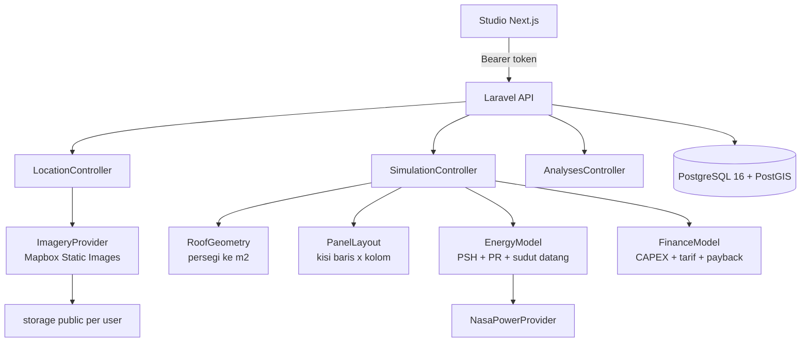

# Sunsight Studio Simulasi PLTS - Plan

## Goal Capsule

- **Objective:** Studio simulasi potensi PLTS atap: pengguna memasukkan koordinat, sistem menampilkan citra satelit nadir nyata, pengguna menempatkan dan mengubah persegi bidang atap, sistem menata modul surya di dalamnya, lalu menampilkan kapasitas, produksi tahunan, penghematan listrik bulanan, dan payback.
- **Authority hierarchy:** `API CONTRACT.md` otoritatif untuk wire format. Plan ini otoritatif untuk urutan dan batas unit. Prototipe pembanding (`aris-ab/Sunsight`) otoritatif untuk **bentuk alur dan cakupan fitur**, **bukan** untuk rumus: tiga rumusnya dikoreksi (lihat KTD-4, KTD-5, KTD-6).
- **Execution profile:** `code`. PHP 8.3 + Laravel 13 + PostgreSQL 16/PostGIS, Next.js 16, Python/OpenCV. Tanpa Docker.
- **What changes vs plan 001:** bentuk produk berpindah dari "poligon atap hasil CV" menjadi "persegi bidang atap yang ditempatkan pengguna". Deteksi bayangan dan orientasi-sumbu-poligon **dibuang** karena tidak lagi relevan. Lapisan finansial naik dari "di luar identitas produk" menjadi inti.
- **Stop conditions:** Hentikan bila (a) token Mapbox tidak tersedia dan tidak ada penyedia citra alternatif yang disetujui, atau (b) resolusi citra pada zoom kerja tidak cukup untuk mengenali batas atap sehingga alur "atap muncul" tidak terpenuhi. Selain itu lanjutkan dengan asumsi yang tercatat.

## Product Contract

### Summary

Sunsight menjadi simulator kelayakan PLTS atap yang bekerja pada satu bidang atap persegi. Pengguna memberi koordinat, melihat citra satelit nadir lokasi itu, mengatur persegi bidang atap beserta parameter teknis (kemiringan, azimuth, setback, talang, jenis modul, tata letak), lalu menerima empat angka utama: kapasitas terpasang, produksi tahunan, penghematan bulanan, dan payback. Simulasi dapat disimpan dan dibuka kembali.

Pembeda dari prototipe pembanding ada tiga: citra satelitnya nyata dan diambil saat itu juga, iradiasinya dari basis data NASA POWER bukan konstanta, dan **seluruh angka hasil dihitung server** sehingga tidak dapat dipalsukan klien.

### Problem Frame

Prototipe pembanding sudah membuktikan bentuk alur dan model finansialnya berjalan, tetapi citranya berkas statis, input iradiasinya konstanta `4.5` tanpa sumber, estimasi produksinya tidak menerapkan faktor rugi sistem, dan tidak ada satu pun pemrosesan citra di dalamnya. Repo ini sudah memiliki fondasi yang justru hilang di prototipe: penyimpanan aset ber-kepemilikan, iradiasi NASA POWER nyata, basis data relasional, autentikasi, kontrak yang diuji, dan batas pemrosesan citra OpenCV. Yang hilang di repo ini adalah bentuk produknya.

### Requirements

**Lokasi dan citra**

- R1. Sistem menerima koordinat dan mengembalikan citra satelit nadir untuk lokasi itu beserta bbox, ukuran citra, dan skala meter per piksel.
- R2. Sumber citra adalah penyedia ubin/static image sungguhan yang dapat dikonfigurasi, bukan berkas contoh yang di-commit.
- R3. Bila kredensial penyedia citra tidak ada, sistem gagal dengan pesan konfigurasi yang jelas, bukan citra kosong.
- R4. Citra disajikan melalui URL yang dapat dimuat browser, dan asetnya hanya diproses oleh pemiliknya.

**Geometri bidang atap**

- R5. Pengguna dapat menggeser, mengubah ukuran, dan memutar satu persegi bidang atap di atas citra.
- R6. Dimensi persegi dinyatakan dalam meter, dihitung dari skala citra milik server.
- R7. Setback keliling dan lebar jalur talang mengurangi luas efektif yang boleh ditempati modul.
- R8. Kemiringan dan azimuth datang sebagai masukan pengguna, dan keduanya memengaruhi produksi melalui faktor sudut datang.
- R9. Luas efektif, luas total bidang, dan jumlah slot modul maksimum dapat dilihat pengguna.

**Tata letak modul**

- R10. Preset modul membawa daya puncak, dimensi fisik, dan efisiensi.
- R11. Sistem menata modul secara otomatis sebagai kisi baris × kolom di dalam area efektif, menghormati jarak antar panel dan orientasi potret atau lanskap.
- R12. Pengguna dapat menyesuaikan jumlah modul terpasang antara nol dan jumlah slot maksimum.
- R13. Sistem melaporkan jumlah modul terpasang, luas modul, dan rasio kerapatan.

**Energi**

- R14. Iradiasi harian rata-rata lokasi berasal dari sumber data nyata, bukan konstanta.
- R15. Produksi tahunan memperhitungkan performance ratio sistem, bukan efisiensi ideal.
- R16. Sistem melaporkan kapasitas terpasang dan produksi tahunan.

**Finansial**

- R17. CAPEX dirinci menjadi modul, inverter, racking, dan instalasi, masing-masing dapat dikonfigurasi dan dapat dikutip.
- R18. Tarif listrik mengikuti golongan PLN yang dapat dipilih pengguna.
- R19. Penghematan bulanan tidak pernah melebihi tagihan listrik bulanan yang dimasukkan pengguna.
- R20. Payback dihitung dari CAPEX dibagi penghematan tahunan.
- R21. Dampak lingkungan dilaporkan sebagai reduksi CO2 memakai faktor emisi yang dikutip sumbernya.

**Hasil dan riwayat**

- R22. Antarmuka menampilkan empat metrik utama: kapasitas, produksi tahunan, penghematan bulanan, dan payback.
- R23. Seluruh angka hasil dihitung server. Klien hanya mengirim masukan, tidak pernah mengirim hasil.
- R24. Simulasi dapat disimpan dan dibuka kembali lengkap dengan masukan dan hasilnya.

**Pemrosesan citra**

- R25. Sistem dapat mengusulkan batas bidang atap secara otomatis dari citra, dan usulan itu selalu dapat disesuaikan pengguna.

### Flows

- F1. Alur simulasi utama
  - **Trigger:** Pengguna terautentikasi memasukkan koordinat dan menekan tombol analisis.
  - **Steps:** FE meminta citra; kanvas menampilkan citra dengan persegi awal; pengguna menggeser/mengubah ukuran/memutar persegi; FE mengirim masukan (persegi piksel, setback, talang, kemiringan, azimuth, preset modul, orientasi, jarak, jumlah modul, tagihan, tarif); server menghitung tata letak, energi, dan finansial; FE menampilkan hasil.
  - **Outcome:** Empat metrik utama tampil, dan nilai antar-tampilan konsisten karena seluruhnya berasal dari satu respons server.
  - **Covered by:** R1, R5, R6, R7, R8, R10, R11, R14, R15, R17, R18, R19, R20, R22, R23
- F2. Alur simpan dan riwayat
  - **Trigger:** Pengguna menekan simpan, lalu membuka riwayat.
  - **Steps:** FE menyimpan masukan simulasi; server menyimpan hasil hitungannya sendiri; FE memuat daftar; pengguna membuka detail; pengguna menghapus.
  - **Outcome:** Simulasi tersimpan dapat dibuka kembali dan angkanya sama seperti saat dihitung.
  - **Covered by:** R24

### Acceptance Examples

- AE1. Angka klien tidak dipercaya
  - **Covers:** R23
  - **Given:** Klien mengirim payload simpan yang menyertakan angka kapasitas karangan.
  - **When:** Permintaan diterima.
  - **Then:** Sistem mengabaikan angka kiriman itu dan menyimpan hasil hitungannya sendiri.
- AE2. Penghematan tidak melebihi tagihan
  - **Covers:** R19
  - **Given:** Tagihan bulanan Rp 500.000 dan produksi bulanan bernilai Rp 2.000.000.
  - **When:** Simulasi dihitung.
  - **Then:** Penghematan bulanan yang dilaporkan tepat Rp 500.000, dan kelebihan produksi tidak diklaim sebagai penghematan.
- AE3. Citra tanpa kredensial
  - **Covers:** R3
  - **Given:** Token penyedia citra tidak dikonfigurasi.
  - **When:** Pengguna meminta citra.
  - **Then:** Sistem mengembalikan pesan yang menyebut nama variabel konfigurasi yang harus diisi.

### Scope Boundaries

**Masuk v1:** seluruh requirement di atas kecuali yang disebut di bawah.

**Ditunda ke tier berikutnya**

- Deteksi rintangan di atas atap (HVAC, skylight, tandon) sebagai objek, bukan sekadar pengecualian manual.
- Bentuk atap limasan dan L, beserta bidang atap jamak.
- Peta panas iradiasi per piksel.
- Pencarian berdasarkan alamat (geocoding) dan peta interaktif yang bisa digeser.
- Ekspor proposal PDF dan formulir permintaan penawaran kontraktor.
- Kurva arus kas 25 tahun dan IRR.

**Di luar identitas produk**

- Kemiringan dan azimuth yang diturunkan dari citra nadir. **Tidak mungkin secara fisik** dari satu citra nadir, dan tetap dinyatakan sebagai masukan pengguna (lihat KTD-4).
- Perencanaan stringing DC, sizing kabel, dan proteksi kelistrikan.
- Simulasi bayangan dari geometri 3D; tidak ada datanya.

### Assumptions

- Token Mapbox tersedia dan dipakai untuk tujuan non-produksi (pengembangan dan demonstrasi), sesuai ToS Mapbox yang mengizinkan "non-production use (i.e., used solely for your internal development, evaluation, testing and demonstration)".
- Pengguna mau menerima atribusi Mapbox tampil di antarmuka; ToS melarang penghapusan tanda kepemilikan, dan menyediakan parameter `attribution=false` bila atribusi ditaruh di antarmuka.
- Citra Mapbox disimpan sebagai berkas lokal untuk keperluan simulasi. Ini wilayah abu-abu ToS ("destroy any materials... downloaded from the Services" saat lisensi berakhir); dicatat sebagai OQ1.
- Satu bidang atap per simulasi; atap jamak belum masuk lingkup.

### Open Questions

- OQ1 (deferred). Kebijakan retensi citra Mapbox. Tidak memblokir karena penyimpanan lokal dapat diganti rujukan sementara; keputusannya menyentuh kepatuhan, bukan bentuk kode.
- OQ2 (deferred). Penyimpanan permanen citra vs ambil ulang tiap simulasi.
- OQ3 (deferred). Runner test frontend belum ada (diwarisi dari plan 001).

## Planning Contract

### Key Technical Decisions

- KTD-1. **Seluruh angka hasil dihitung server; klien hanya mengirim masukan.** Ini menutup celah integritas yang ditemukan pada implementasi sebelumnya, di mana `POST /analyses` menerima `usable_area_sqm` dan `estimated_energy_kwh_per_day` apa adanya sehingga klien dapat mengarang hasil. Endpoint simpan menerima masukan saja dan menghitung ulang.
- KTD-2. **Sumber citra adalah Mapbox Static Images API dengan gaya `satellite-v9`.** Ia mengembalikan satu citra untuk satu bbox (bukan ubin yang harus dijahit), proyeksinya Web Mercator sehingga rumus piksel ke geografis yang sudah ada tetap sahih, dan batas ukurannya 1280×1280. Implementasi masuk sebagai `MapboxImageryProvider` di balik antarmuka `ImageryProvider` yang sudah ada.
- KTD-3. **Penyimpan aset citra tidak lagi memaksa ekstensi `.png`.** Gaya raster Mapbox mengembalikan JPEG; menyimpannya dengan nama `.png` membuat ekstensi berbohong dan merusak apa pun yang mempercayainya. Ekstensi ditentukan dari tipe MIME sebenarnya.
- KTD-4. **Kemiringan dan azimuth adalah masukan pengguna, bukan hasil deteksi.** Dari satu citra nadir, arah kemiringan tidak dapat ditentukan; klaim "deteksi azimuth & kemiringan otomatis" pada prototipe pembanding tidak didukung implementasinya dan tidak mungkin secara metode. Pengaruhnya ke produksi dihitung lewat faktor sudut datang terhadap posisi matahari.
- KTD-5. **Iradiasi dari NASA POWER, bukan konstanta.** Prototipe pembanding memakai `peakSunHours = 4.5` tanpa sumber. Repo ini sudah memiliki `NasaPowerProvider` dengan cache dan jalur cadangan; nilai tahunan dari sumbernya dipakai, dan nilai cadangan tetap ditandai bila sumber tidak dapat dihubungi.
- KTD-6. **Performance ratio diterapkan pada produksi.** Prototipe pembanding menghitung `kWp × PSH × 365 × 1.0` sehingga produksinya sekitar 20% terlalu optimistis. Sistem nyata rugi karena suhu, kabel, inverter, dan kotoran, sehingga produksi memakai performance ratio dari konfigurasi.
- KTD-7. **Persegi bidang atap, bukan poligon bebas.** Mengikuti prototipe pembanding. Persegi cukup untuk bidang atap utama, jauh lebih mudah diubah pengguna, dan membuat tata letak kisi baris × kolom menjadi masalah yang terdefinisi.
- KTD-8. **Batas antara aplikasi dan pemrosesan citra tetap di `CvClient`.** Usulan otomatis batas atap masuk sebagai implementasi baru di balik antarmuka itu, sehingga alur manual tidak bergantung padanya dan kegagalan CV tidak mematikan demo.
- KTD-9. **Seluruh konstanta biaya, tarif, dan modul berada di berkas konfigurasi.** Angka finansial harus dapat dikutip, diuji, dan diubah tanpa menyentuh logika; ini juga yang membuat angkanya dapat dipertanggungjawabkan di laporan.

### High-Level Technical Design

Kontrak internal:

- `ImageryProvider::fetch(lat, lng, zoom, userId): ImageryAsset` (sudah ada).
- `RoofGeometry::effectiveArea(rectPx, metersPerPixel, setbackM, gutterM): RoofArea`.
- `PanelLayout::fit(area, module, orientation, clearanceM, requestedCount): LayoutResult`.
- `EnergyModel::estimate(capacityKwp, tiltDeg, azimuthDeg, lat, lng): EnergyResult`.
- `FinanceModel::summarise(capex, annualKwh, monthlyBill, tariff): FinanceResult`.

### Risiko dan Dependensi

- Resolusi citra Mapbox pada zoom kerja mungkin tidak cukup untuk mengenali batas atap. Mitigasi: persegi ditempatkan pengguna, jadi alur tidak bergantung pada ketajaman tepi; usulan otomatis bersifat tambahan.
- ToS Mapbox melarang penggunaan produksi untuk aplikasi yang berkaitan dengan real estate atau analytics tanpa lisensi komersial. Untuk demonstrasi dan pengembangan diizinkan; dicatat di laporan sebagai batasan.
- Perjalanan bolak-balik ke API Mapbox menambah latensi. Mitigasi: citra disimpan setelah diambil, dan simulasi berulang tidak mengambil ulang.
- Angka finansial mudah diperdebatkan. Mitigasi: seluruh konstanta di konfigurasi, dirujuk sumbernya, dan blok asumsi ikut tersimpan bersama tiap simulasi.

## Implementation Units

| Unit | Judul | Berkas utama | Bergantung pada |
|---|---|---|---|
| U1 | Bekukan kontrak API v2 | `API CONTRACT.md` | — |
| U2 | Penyedia citra Mapbox dan perbaikan ekstensi aset | `be/app/Services/Imagery/` | U1 |
| U3 | Konfigurasi modul, tarif, dan biaya | `be/config/solar.php`, `be/config/plts.php` | — |
| U4 | Mesin geometri bidang atap | `be/app/Services/RoofGeometry.php` | — |
| U5 | Mesin tata letak modul | `be/app/Services/PanelLayout.php` | U3, U4 |
| U6 | Model energi dengan iradiasi nyata dan performance ratio | `be/app/Services/EnergyModel.php` | U3 |
| U7 | Model finansial | `be/app/Services/FinanceModel.php` | U3 |
| U8 | Endpoint simulasi dan penyimpanan | `be/app/Http/Controllers/SimulationController.php` | U2–U7 |
| U9 | Migrasi dan model simulasi tersimpan | `be/database/migrations/`, `be/app/Models/` | U3 |
| U10 | Studio: kanvas citra dan editor persegi | `fe/src/app/studio/page.tsx`, `fe/src/components/RoofRectEditor.tsx` | U1, U2 |
| U11 | Panel parameter dan panel hasil | `fe/src/components/ParameterPanel.tsx`, `fe/src/components/MetricStrip.tsx` | U8, U10 |
| U12 | Riwayat simulasi | `fe/src/app/history/page.tsx` | U8 |
| U13 | Bersihkan sisa produk lama | `be/app/Services/Cv/`, `fe/src/components/ImageryCanvas.tsx` | U8 |
| U14 | Verifikasi end-to-end dan bukti | — | U10–U13 |

### Milestone A — Alur simulasi hidup

### U1. Bekukan kontrak API v2

- **Goal:** Kontrak yang memuat endpoint lokasi, simulasi, dan riwayat dengan bentuk yang tidak ambigu.
- **Requirements:** R1, R23, R24
- **Files:** `API CONTRACT.md`
- **Approach:** Ganti isi kontrak ke bentuk produk baru. Endpoint: `POST /location` (koordinat menjadi citra + bbox + skala), `POST /simulate` (masukan lengkap menjadi hasil hitungan server), `POST /analyses` (menyimpan masukan, server menghitung ulang), `GET /analyses`, `GET /analyses/{id}`, `DELETE /analyses/{id}`. Pertegas bahwa payload simpan **tidak memuat** angka hasil, dan sebutkan akibatnya bagi klien: mengirim angka hasil tidak akan berpengaruh. Endpoint lama produk poligon (`/cv/refine-polygon`, `/cv/detect-shadow`, `/solar/calculate`) dihapus dari kontrak.
- **Test Scenarios:** Setiap endpoint punya contoh payload dan respons. Payload `POST /analyses` tidak memuat satu pun kunci hasil (kapasitas, produksi, hemat, payback, capex). Satuan dan rentang setiap masukan tertulis. Contoh tarif menyebut tahun berlakunya.
- **Verification:** Berkas terbaca tanpa pertanyaan tersisa, dan tidak ada endpoint produk lama yang masih tercantum.

### U2. Penyedia citra Mapbox dan perbaikan ekstensi aset

- **Goal:** Citra satelit nyata untuk koordinat, dengan ekstensi berkas yang jujur.
- **Requirements:** R1, R2, R3, R4
- **Files:** `be/app/Services/Imagery/MapboxImageryProvider.php`, `be/app/Services/Imagery/ImageryAssetStore.php`, `be/config/imagery.php`, `be/.env.example`
- **Approach:** Tambahkan penyedia yang memanggil Mapbox Static Images untuk bbox hasil perhitungan sendiri, gaya `satellite-v9`, ukuran sampai 1280, memakai token dari konfigurasi. Bila token kosong, lempar kegagalan konfigurasi yang menyebut `MAPBOX_ACCESS_TOKEN`. Perbaiki `ImageryAssetStore` agar ekstensi ditentukan dari tipe MIME sebenarnya dan disimpan di kolom metadata, sehingga lookup tidak lagi menebak. Penyedia `sample` tetap ada sebagai jalur mundur saat token belum tersedia, dan pemilihannya lewat konfigurasi.
- **Test Scenarios:** Tanpa token, penyedia Mapbox gagal dengan pesan yang menyebut nama variabel konfigurasi. Dengan `Http::fake` yang mengembalikan JPEG, berkas tersimpan berakhiran `.jpg` dan tipe MIME-nya tercatat. Berkas berakhiran `.png` tetap tersimpan sebagai `.png`. Lookup aset menemukan berkas apa pun ekstensinya. URL permintaan memuat bbox berurutan `[minLng, minLat, maxLng, maxLat]` dan gaya `satellite-v9`. Permintaan dari user lain tetap ditolak.
- **Verification:** `php artisan test --filter=ImageryTest` lulus, termasuk kasus JPEG.

### U3. Konfigurasi modul, tarif, dan biaya

- **Goal:** Seluruh angka teknis dan finansial dapat dikutip, diuji, dan diubah tanpa menyentuh logika.
- **Requirements:** R10, R17, R18, R21
- **Files:** `be/config/plts.php`, `be/config/solar.php`
- **Approach:** Pindahkan preset modul (daya puncak, panjang, lebar, efisiensi), tarif PLN per golongan beserta tahun berlakunya, biaya per komponen (harga modul, biaya inverter per kWp dan per modul, racking per modul, instalasi tetap), performance ratio, faktor emisi CO2, dan serapan per pohon ke konfigurasi. Setiap entri membawa rujukan singkat sumber atau dasar angkanya.
- **Test Scenarios:** Tiap golongan tarif punya nilai dan tahun. Tiap preset modul punya daya, dimensi, dan efisiensi yang konsisten satuannya. Performance ratio berada di rentang wajar. Faktor emisi mencantumkan satuannya.
- **Verification:** Konfigurasi dimuat tanpa galat dan seluruh kunci yang dipakai unit lain tersedia.

### U4. Mesin geometri bidang atap

- **Goal:** Luas efektif dalam meter persegi dari persegi bidang atap.
- **Requirements:** R5, R6, R7, R9
- **Files:** `be/app/Services/RoofGeometry.php`, `be/app/Services/Geometry/RoofArea.php`
- **Approach:** Terima persegi dalam koordinat piksel beserta skala meter per piksel dari metadata aset, setback keliling, dan lebar jalur talang. Hitung luas total dan luas efektif dengan mengurangi setback pada tiap sisi dan jalur talang pada satu sisi. Persegi dapat berotasi sehingga luas tetap dihitung dari panjang dan lebar sebenarnya, bukan dari kotak pembatasnya.
- **Test Scenarios:** Skala nol atau negatif ditolak. Setback yang lebih besar dari setengah sisi menghasilkan luas efektif nol, bukan negatif. Rotasi tidak mengubah luas dan tidak menukar sisi, karena panjang dan lebar adalah dimensi persegi itu sendiri. Luas total sebanding dengan kuadrat skala. Jalur talang mengurangi luas sebesar lebar talang dikali sisi yang bersangkutan. Sudut hasil rotasi jatuh di tempat yang benar terhadap pusat persegi.
- **Verification:** `php artisan test --filter=RoofGeometryTest` lulus.

### U5. Mesin tata letak modul

- **Goal:** Jumlah modul yang benar-benar muat, beserta tata letaknya.
- **Requirements:** R10, R11, R12, R13
- **Files:** `be/app/Services/PanelLayout.php`, `be/app/Services/Geometry/LayoutResult.php`
- **Approach:** Susun kisi baris × kolom dari dimensi area efektif dibagi dimensi modul (ditukar bila orientasi lanskap) ditambah jarak antar panel. Hitung slot maksimum, lalu terapkan jumlah yang diminta pengguna dengan memotongnya ke rentang nol sampai maksimum. Laporkan jumlah terpasang, luas modul, dan rasio kerapatan.
- **Test Scenarios:** Area yang lebih kecil dari satu modul menghasilkan nol slot, bukan satu. Orientasi lanskap menukar jumlah baris dan kolom. Jarak antar panel memperbanyak jumlah yang muat. Jumlah yang diminta di atas maksimum dipotong ke maksimum. Jumlah yang diminta negatif menjadi nol. Kapasitas sama dengan jumlah terpasang dikali daya modul.
- **Verification:** `php artisan test --filter=PanelLayoutTest` lulus.

### U6. Model energi dengan iradiasi nyata dan performance ratio

- **Goal:** Produksi tahunan yang dapat dipertanggungjawabkan.
- **Requirements:** R8, R14, R15, R16
- **Files:** `be/app/Services/EnergyModel.php`
- **Approach:** Ambil iradiasi harian dari penyedia iradiasi yang ada, terapkan faktor sudut datang dari kemiringan dan azimuth terhadap lintang lokasi, lalu hitung produksi tahunan sebagai kapasitas dikali iradiasi harian efektif dikali tiga ratus enam puluh lima dikali performance ratio. Faktor sudut datang **dinormalisasi terhadap bidang horizontal** sehingga bidang datar bernilai tepat 1,0; tanpa normalisasi itu, hasilnya terhitung sekitar seperempat terlalu rendah karena iradiasi dari sumbernya juga besaran bidang horizontal. Faktor dihitung dengan mengintegrasikan posisi matahari per jam untuk dua belas bulan perwakilan, karena rata-rata tengah hari saja tidak dapat membedakan azimuth: pada tengah hari, modul menghadap utara dan selatan menerima sudut datang yang serupa. Bawa nilai iradiasi, faktor sudut, dan performance ratio keluar sebagai asumsi.
- **Test Scenarios:** Faktor bidang datar tepat 1,0 pada lintang mana pun. Produksi sebanding dengan kapasitas. Performance ratio nol menghasilkan produksi nol, dan performance ratio benar-benar diterapkan pada hasilnya. Di lintang selatan modul menghadap utara lebih baik daripada menghadap selatan, dan sebaliknya di lintang utara. Kemiringan yang terlalu curam menurunkan faktor. Selisih azimuth kecil hampir tidak berpengaruh. Pemanggilan berulang dengan masukan sama memberi angka sama. Asumsi memuat nilai iradiasi, sumbernya, dan performance ratio. Kegagalan sumber iradiasi memakai nilai cadangan yang ditandai.
- **Verification:** `php artisan test --filter=EnergyModelTest` lulus tanpa jaringan.

### U7. Model finansial

- **Goal:** CAPEX, penghematan bulanan, dan payback yang jujur.
- **Requirements:** R17, R18, R19, R20, R21
- **Files:** `be/app/Services/FinanceModel.php`, `be/app/Services/Finance/CostBreakdown.php`
- **Approach:** Hitung CAPEX dari harga modul dikali jumlah, biaya inverter, racking, dan instalasi tetap. Hitung nilai produksi bulanan memakai tarif golongan yang dipilih, lalu batasi penghematan pada tagihan bulanan pengguna. Payback adalah CAPEX dibagi penghematan tahunan. Reduksi CO2 memakai faktor emisi dan ekivalen pohon. Semua konstanta dari konfigurasi dan ikut dilaporkan sebagai rincian.
- **Test Scenarios:** Penghematan tidak pernah melebihi tagihan, termasuk saat produksi jauh lebih besar. Payback adalah CAPEX dibagi penghematan tahunan. Tanpa modul terpasang, CAPEX hanya biaya instalasi dan payback menjadi tak terhingga. Rincian CAPEX menjumlah tepat ke totalnya. Tarif yang dipilih benar-benar mengubah penghematan. Reduksi CO2 sebanding dengan energi yang benar-benar menggantikan listrik, bukan seluruh produksi.
- **Verification:** `php artisan test --filter=FinanceModelTest` lulus.

### U8. Endpoint simulasi dan penyimpanan

- **Goal:** Simulasi dihitung server, dan angka klien tidak pernah dipercaya.
- **Requirements:** R1, R22, R23, R24
- **Files:** `be/app/Http/Controllers/SimulationController.php`, `be/app/Http/Requests/SimulateRequest.php`, `be/app/Http/Requests/StoreSimulationRequest.php`, `be/app/Http/Resources/SimulationResource.php`, `be/routes/api.php`
- **Approach:** `POST /location` mengembalikan identitas citra dan skalanya. `POST /simulate` menerima seluruh masukan, menjalankan keempat mesin, dan mengembalikan hasil beserta asumsi dan rincian biaya tanpa menyimpan apa pun. `POST /analyses` menerima masukan yang sama dan menghitung ulang di server sebelum menyimpan; kunci hasil pada payload kiriman diabaikan, bukan ditolak, supaya klien lama tidak rusak. Daftar dan detail memakai bentuk ringkas dan bentuk lengkap seperti kontrak.
- **Test Scenarios:** Simulasi mengembalikan keempat metrik utama dan tidak menulis baris apa pun. Menyimpan simulasi dengan angka hasil karangan menghasilkan baris yang angkanya adalah hasil hitungan server, bukan angka kiriman. Seluruh endpoint menolak permintaan tanpa token. Nilai di luar rentang masuk ditolak dengan pesan per-field. Detail simulasi memuat kembali asumsi yang dipakai. Riwayat milik user lain tidak dapat dibuka maupun dihapus, dan tidak dapat dibedakan dari yang tidak ada.
- **Verification:** `php artisan test --filter=SimulationTest` lulus.

### U9. Migrasi dan model simulasi tersimpan

- **Goal:** Simulasi tersimpan lengkap: masukan, hasil, dan asumsi.
- **Requirements:** R24
- **Files:** `be/database/migrations/*_create_simulations_table.php`, `be/app/Models/Simulation.php`
- **Approach:** Buat tabel `simulations` dengan pemilik, koordinat, identitas aset citra, geometri persegi dalam koordinat geografis, parameter bidang atap, parameter modul, serta seluruh kolom hasil (kapasitas, produksi, penghematan, payback, CO2) dan kolom asumsi. Tabel `roof_analyses` dari produk lama dihapus bersama modelnya karena tidak lagi dipakai.
- **Test Scenarios:** Baris tersimpan memuat seluruh kolom hasil. Menghapus user menghapus simulasinya. Geometri tersimpan valid menurut PostGIS. Kolom asumsi wajib terisi.
- **Verification:** `php artisan migrate:fresh --seed` bersih dan tes model lulus.

### U10. Studio: kanvas citra dan editor persegi

- **Goal:** Pengguna menempatkan dan mengubah persegi bidang atap di atas citra nyata.
- **Requirements:** R5, R6, R9
- **Files:** `fe/src/app/studio/page.tsx`, `fe/src/components/RoofRectEditor.tsx`
- **Approach:** Halaman menerima koordinat, meminta citra ke server, lalu menampilkan citra dengan persegi di atasnya. Persegi punya satu handle geser di badan dan handle ubah ukuran di sudut, serta kontrol putar. Dimensi dalam meter ditampilkan terus menerus dan dihitung memakai skala dari server.
- **Test Scenarios:** Memuat citra menampilkan persegi awal di tengah. Menggeser badan persegi tidak mengubah dimensinya. Mengubah ukuran sudut mengubah dimensi dalam meter secara proporsional. Memutar persegi tidak mengubah luas total. Dimensi yang tampil cocok dengan perhitungan ulang memakai skala server. Bila citra gagal dimuat, muncul pesan yang dapat dibaca.
- **Verification:** `npm run build`, `npx tsc --noEmit`, `npm run lint` bersih; alur ditempuh di browser.

### U11. Panel parameter dan panel hasil

- **Goal:** Pengguna mengubah parameter dan langsung melihat empat metrik.
- **Requirements:** R8, R10, R12, R22, R23
- **Files:** `fe/src/components/ParameterPanel.tsx`, `fe/src/components/MetricStrip.tsx`, `fe/src/components/ResultDetails.tsx`
- **Approach:** Panel parameter memuat kemiringan, azimuth, setback, talang, preset modul, orientasi, jarak antar panel, jumlah modul, tagihan bulanan, dan golongan tarif. Setiap perubahan memicu permintaan simulasi ke server dengan penundaan singkat agar tidak membanjiri. Panel hasil menampilkan empat metrik utama, rincian CAPEX, dan tabel asumsi.
- **Test Scenarios:** Mengubah kemiringan mengubah produksi. Mengubah jumlah modul mengubah kapasitas dan hemat. Menggeser persegi memicu hitung ulang. Mengubah tagihan menjadi lebih kecil membuat penghematan ikut turun. Selama permintaan berjalan, kontrol dinonaktifkan agar tidak ada pengiriman ganda. Kegagalan menampilkan pesan dan tidak mengunci antarmuka.
- **Verification:** `npm run build`, `npx tsc --noEmit`, `npm run lint` bersih; alur ditempuh di browser.

### U12. Riwayat simulasi

- **Goal:** Simulasi tersimpan dapat dibuka dan dihapus.
- **Requirements:** R24
- **Files:** `fe/src/app/history/page.tsx`, `fe/src/components/HistoryTable.tsx`
- **Approach:** Sesuaikan halaman riwayat ke bentuk simulasi: kolom kapasitas, produksi, hemat bulanan, payback. Detail menampilkan asumsi dan rincian CAPEX yang tersimpan.
- **Test Scenarios:** Simulasi yang baru disimpan muncul di daftar. Detail menampilkan asumsi tersimpan. Menghapus menghilangkan barisnya tanpa muat ulang manual. Halaman hanya memuat milik user aktif.
- **Verification:** `npm run build` dan penelusuran di browser.

### U13. Bersihkan sisa produk lama

- **Goal:** Tidak ada kode jalur mati dari produk poligon.
- **Requirements:** R23
- **Files:** `be/app/Services/Cv/`, `be/app/Services/SolarCalculator.php`, `fe/src/components/ImageryCanvas.tsx`, `fe/src/app/analysis/`
- **Approach:** Hapus deteksi bayangan, perapian poligon, kalkulator surya lama, kanvas poligon, dan halaman analisis lama beserta test-nya. Pertahankan `CvClient` sebagai batas untuk usulan otomatis di tier berikutnya, atau hapus juga bila tidak ada implementasi yang tersisa.
- **Test Scenarios:** `php artisan test` lulus tanpa test yang menunjuk berkas terhapus. `php artisan route:list` tidak memuat endpoint produk lama. `npm run build` lulus tanpa impor yang menggantung.
- **Verification:** Suite penuh hijau dan daftar rute hanya memuat endpoint kontrak v2.

### U14. Verifikasi end-to-end dan bukti

- **Goal:** Alurnya terbukti bekerja dari koordinat sampai angka finansial.
- **Requirements:** R22, R23
- **Files:** `docs/CHECKLIST.md`
- **Approach:** Tandai setiap requirement pada checklist dengan cara pembuktiannya. Ubah checklist lama ke bentuk produk baru dan tandai apa yang kini tidak berlaku.
- **Test Scenarios:** Empat metrik tampil di browser. Angka berubah ketika parameter berubah. Simpan lalu buka kembali memberi angka yang sama. Tidak ada endpoint yang mengembalikan 500 untuk masukan tidak valid.
- **Verification:** Tangkapan layar studio beserta angka, dan suite serta gerbang mutu hijau.

### Tier berikutnya

- **Usulan otomatis batas atap** dari citra lewat analisis tepi, masuk sebagai implementasi kedua `CvClient`.
- **Deteksi rintangan** di atas atap untuk mengecualikan slot.
- **Bidang atap jamak** dengan bentuk limasan dan L.
- **Ekspor PDF** dan kurva arus kas.

## Verification Contract

| Gerbang | Perintah | Berlaku untuk |
|---|---|---|
| Migrasi bersih | `cd be && php artisan migrate:fresh --seed` | U9 |
| Test backend | `cd be && php artisan test` | U2, U4, U5, U6, U7, U8, U9 |
| Gaya kode PHP | `cd be && ./vendor/bin/pint --test` | semua unit backend |
| Daftar rute | `cd be && php artisan route:list --path=api` | U8, U13 |
| Build FE | `cd fe && npm run build` | U10, U11, U12, U13 |
| Tipe FE | `cd fe && npx tsc --noEmit` | U10, U11, U12 |
| Lint FE | `cd fe && npm run lint` | U10, U11, U12 |
| Smoke alur | backend dan frontend jalan, alur F1 ditempuh di browser | U14 |
| Bukti | tangkapan layar studio dengan empat metrik tampil | U14 |

Gerbang wajib sebelum Milestone A dinyatakan selesai: migrasi bersih, test backend, build FE, tipe FE, lint FE, dan smoke alur penuh.

## Definition of Done

**Global**

- Seluruh requirement R1 sampai R24 terpenuhi dan dapat ditunjukkan.
- Tidak ada endpoint yang menerima angka hasil dari klien; angka hasil selalu berasal dari perhitungan server. Dibuktikan oleh AE1.
- `API CONTRACT.md` cocok dengan perilaku nyata dan tidak memuat endpoint produk lama.
- Batasan yang diakui tercatat di kode dan laporan: kemiringan dan azimuth tidak diturunkan dari citra, citra Mapbox dipakai untuk tujuan non-produksi dengan atribusi tampil, dan usulan otomatis batas atap bersifat tambahan.
- Seluruh konstanta finansial berada di konfigurasi dan dapat dikutip sumbernya.
- Kode jalur mati dari produk poligon dihapus, bukan ditinggalkan.

**Per unit**

- Setiap unit memenuhi seluruh Test Scenarios-nya, dan Verifikasinya dijalankan.
- Setiap unit yang menambahkan perilaku baru menyertakan test pada berkas test yang disebutkan di kolom Files.
- Setiap unit yang mengubah bentuk wire format memperbarui `API CONTRACT.md` pada perubahan yang sama.
